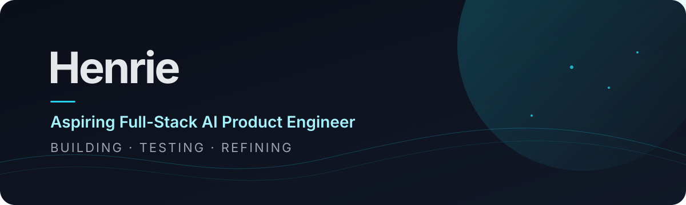
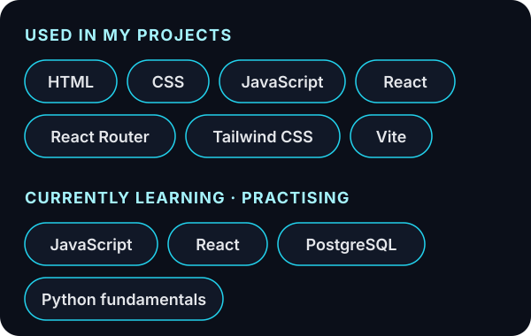
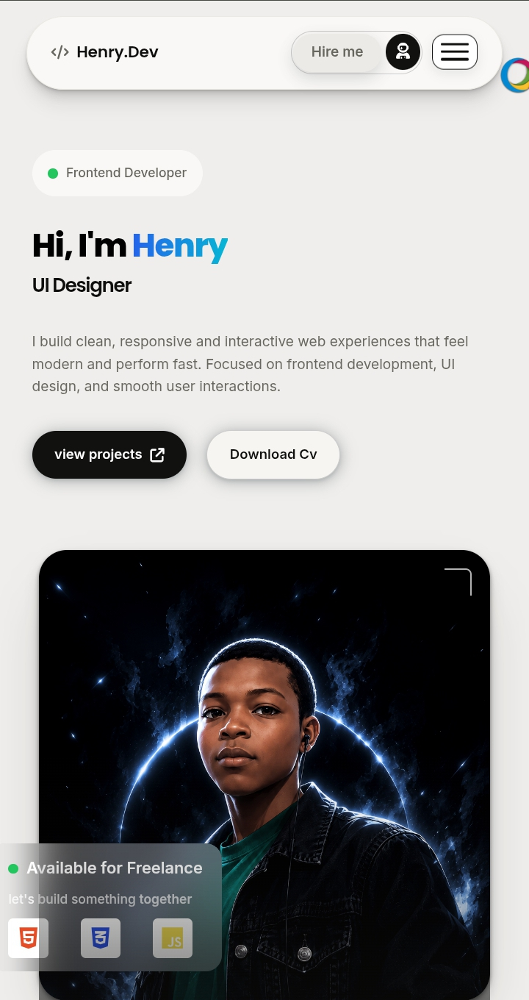
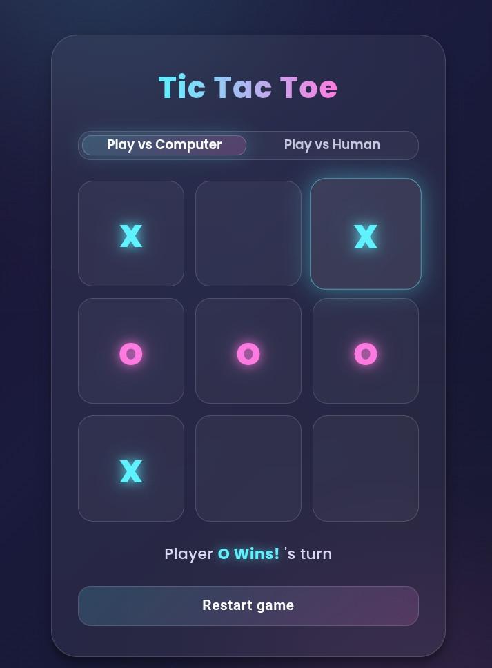
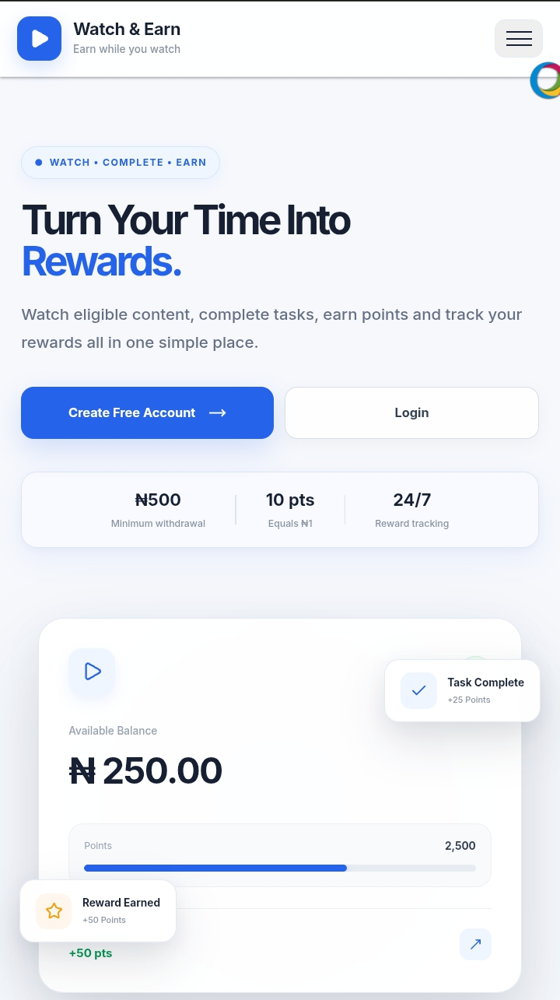
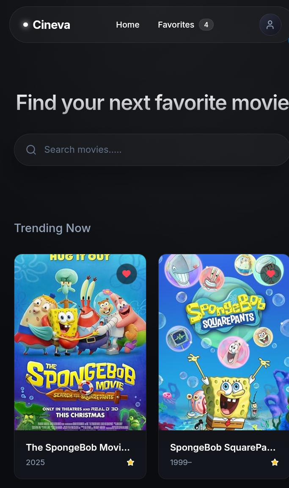
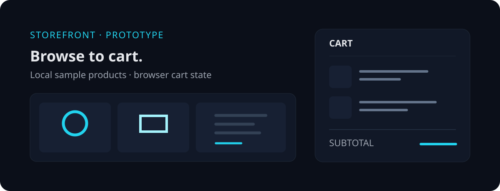

  <picture>
    <source media="(prefers-color-scheme: light)" srcset="assets/banner-light.svg">
    
  </picture>

  I build small, usable web products—from interactive browser experiences to React applications—and use each one to understand how interface, state, and behavior fit together.

  

## Tech showcase

<picture>
  <source media="(prefers-color-scheme: light)" srcset="assets/tech-chips-light.svg">
  
</picture>

## Featured projects

### Portfolio-V1-test

  

A multi-section personal portfolio prototype with project, services, and about sections. Its contact form currently simulates a sent message in client-side code; it does not deliver messages.

**Stack:** HTML · CSS · JavaScript  
[Repository](https://github.com/Henrie-x/Portfolio-V1-test) · [Live demo](https://portfolio-six-liard-ycxny8mivv.vercel.app/)

### Tic-Tac-Toe

  

A browser game with player-versus-player and player-versus-computer modes, win and draw detection, and a restart control.

**Stack:** HTML · CSS · JavaScript  
[Repository](https://github.com/Henrie-x/Tic-Tac-Toe) · [Live demo](https://tic-tac-toe-opal-eta-35.vercel.app/)

### watch-and-earn

  

A rewards-platform prototype with account, dashboard, video, points, and withdrawal interfaces. The project uses browser storage for basic data; it is not a production-ready financial service.

**Stack:** React · JavaScript · React Router · Vite  
[Repository](https://github.com/Henrie-x/watch-and-earn) · [Live demo](https://watch-and-earn-4fnb.vercel.app)

### cineva-movies

  

A movie-search frontend using the OMDb API. It supports searching titles, saving and removing favourites, and storing favourites in the browser.

**Stack:** React · JavaScript · CSS · Vite  
[Repository](https://github.com/Henrie-x/cineva-movies) · [Live demo](https://cineva-movies.vercel.app/)

### E-commerce-

<picture>
  
</picture>

An e-commerce storefront prototype with local sample product data and browser-stored cart state. The repository README notes that it has no backend, database, payment gateway, or server-side order processing.

**Stack:** React · JavaScript · Tailwind CSS · Vite  
[Repository](https://github.com/Henrie-x/E-commerce-) · [Live demo](https://e-commerce-puce-one-43.vercel.app/)

## About me

My projects are a way to make software concepts tangible: a game’s rules, a movie search, or a cart that keeps its state. I’m building toward full-stack AI product engineering, with JavaScript and React practice alongside Python fundamentals and PostgreSQL.

## GitHub activity

  <picture>
    <source media="(prefers-color-scheme: light)" srcset="https://raw.githubusercontent.com/Henrie-x/HENRIE-X/output/github-contribution-grid-snake.svg">
    
  </picture>

## Connect

- [GitHub](https://github.com/Henrie-x)
- [Email](mailto:ogbonnah404@gmail.com)
- [X](https://x.com/HenryOgbon45088)
